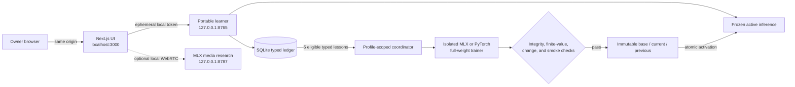

# TinyDog

TinyDog is a local, owner-trained language-model experiment. You talk to a small pet in a browser, and your **typed replies** become training examples for your own local model. The normal path runs on macOS, Windows, or Linux and does not require an account, API key, cloud model, or computer-science knowledge.

> [!WARNING]
> **Research alpha — not a pretrained assistant.** TinyDog starts from deterministic random weights unless you explicitly provide and audit a compatible foundation bundle. It may produce repetition, fragments, nonsense, unsafe text, or regress after training. Five conversational examples are enough to trigger an update, not enough to make a generally capable or reliable assistant. Do not use TinyDog for medical, legal, financial, safety-critical, or factual decisions.

## What TinyDog is — and is not

TinyDog is:

- local-first: the normal runtime binds only to loopback;
- owner-specific: each owner trains a private local lineage;
- conversational: typed replies are the training interface;
- full-foundation by default: every canonical model parameter is eligible for optimization;
- recoverable: immutable base/current/previous generations support rollback, reset, restore, and erasure;
- portable: one canonical model format is used by MLX on Apple Silicon and PyTorch elsewhere.

TinyDog is not:

- a pretrained general assistant;
- a cloud service or world-training network;
- a guarantee that every five-turn update improves the model;
- a private enclave—other processes with your operating-system permissions can read its files;
- a native speech model, vision-language model, or mobile training app.

## Quick start

### Requirements

| Requirement | Minimum / expectation |
| --- | --- |
| Python | 3.10 or newer |
| Node.js | 22.13 or newer for the normal browser interface; use a [currently supported LTS release](https://nodejs.org/en/about/previous-releases) |
| npm | Included with a normal Node.js installation |
| Network | Required on first setup to download Python and npm packages |
| Storage | Several GB free is sensible once runtimes, dependencies, and model generations are included |
| Permissions | A writable project directory; keep it inside your own user profile |
| Ports | Local ports 3000 and 8765 free; optional MLX media research also uses 8787 |

No language-model checkpoint or conversation corpus is downloaded by the normal setup. TinyDog creates its initial foundation locally.

### Start the app

Optional: choose a brain size first. This opens a numbered menu and remembers
the answer, so no configuration file or source code needs editing:

| Operating system | Command |
| --- | --- |
| macOS / Linux | `./tinydog.sh model` |
| Windows Command Prompt | `tinydog.cmd model` |
| Windows PowerShell | `.\tinydog.ps1 model` |

Choose 1–6 for 20M, 50M, 80M, 100M, 200M, or 300M. The 20M choice is
recommended for an older, low-memory, or CPU-only computer. You can also set
it directly, for example `./tinydog.sh model 50m` or `tinydog.cmd model 50m`.
The choice takes effect on the next start.

Open a terminal in this directory and run the launcher for your operating system:

| Operating system | Command |
| --- | --- |
| macOS / Linux | `./tinydog.sh start` |
| macOS / Linux if the file is not executable | `sh tinydog.sh start` |
| Windows Command Prompt | `tinydog.cmd start` |
| Windows PowerShell | `.\tinydog.ps1 start` |

`start` performs setup when needed and starts the local learner and browser interface. Open the canonical same-origin URL [http://localhost:3000](http://localhost:3000) yourself; the launcher prints the address but does not open a browser. Leave the terminal open and press `Ctrl+C` there to stop TinyDog. Use this `localhost` URL rather than substituting another loopback spelling; mutation requests enforce the exact local origin.

For a text-only installation and launch:

| Operating system | Command |
| --- | --- |
| macOS / Linux | `./tinydog.sh start --no-realtime` |
| Windows Command Prompt | `tinydog.cmd start --no-realtime` |
| Windows PowerShell | `.\tinydog.ps1 start --no-realtime` |

`--no-realtime` skips the optional realtime media dependencies and gateway. Typed chat and typed conversational training still work.

### Talk to train

Click the pet’s **“Talk to train me.”** bubble or use:

- `Command+B` on macOS, or `Ctrl+B` on Windows/Linux, to open the text composer;
- `Enter` to send;
- `Shift+Enter` for a new line;
- `Escape` to close the composer;
- `Command+V` on macOS, or `Ctrl+V` on Windows/Linux, to cycle pets **while focus is outside a text field or editor**.

Normal paste remains available inside text fields and editors.

Keep early replies short and concrete. The default personal-training context is 128 tokens; an oversized reply is rejected and does not advance the five-turn counter.

## What “training every five turns” means

The counter is not five complete back-and-forth conversations. It is **five distinct, eligible human replies typed into TinyDog**.

1. On the first exchange, TinyDog treats the human’s typed text as the desired continuation of the fixed prompt `Start a natural conversation.`
2. On later exchanges, TinyDog first generates its response. The human’s next typed reply becomes the desired continuation of that preceding model response.
3. The model’s own generated text is context only. It is never trusted as the correct answer.
4. TinyDog durably commits the typed lesson with trusted typed provenance.
5. After five new eligible lessons, it starts a full-foundation update in the background.
6. The update trains on all five new lessons plus a deterministic replay sample of older lessons—up to eight older lessons with the shipped defaults.

A lesson does not count if it is duplicated, quarantined, untrusted, not typed, or too large for the bounded training context. Audio, camera frames, VAD events, and model-generated messages do not count.

The eligible counter is durable in SQLite, so the five replies can span browser sessions or restarts. For the active session, the UI restores at most 64 recent messages and displays the latest four; inference uses the latest eight stored messages and generates at most 32 new tokens by default. Older messages remain in the database until reset or erasure even when they are outside those display/inference windows.

### What changes

The immutable initial base under `data/models/` does not change. A successful training cycle creates a new personal foundation generation under `data/personal-foundations/` and atomically makes that generation active.

By default, all canonical foundation parameters are optimizer-eligible. That does **not** mean every scalar necessarily changes in one small update: some parameters may receive sparse or zero gradient. Optimizer state is currently reset for every five-turn cycle.

Live inference remains on a frozen model while an isolated copy trains. On successful validation, TinyDog atomically swaps to the new generation. The registry retains the initial base, current generation, and previous generation for recovery.

### What validation proves

Before activation, TinyDog verifies:

- schema and model identity;
- file checksums;
- finite parameters and finite training values;
- that the checkpoint actually changed;
- a forward-pass smoke test.

One deterministic member of the same five-example batch is measured before and after training. This is **in-sample telemetry**, not a held-out evaluation and not a quality promotion gate. A structurally valid candidate is promoted even when that measured loss is worse.

In other words: a lower displayed loss can be encouraging, but neither the five-turn threshold nor promotion proves that the model became more useful. It can improve, remain effectively unchanged, overfit, forget, or regress.

### See what happened

With TinyDog running, open a second terminal:

| Operating system | Human-readable | Machine-readable |
| --- | --- | --- |
| macOS / Linux | `./tinydog.sh status` | `./tinydog.sh status --json` |
| Windows Command Prompt | `tinydog.cmd status` | `tinydog.cmd status --json` |
| Windows PowerShell | `.\tinydog.ps1 status` | `.\tinydog.ps1 status --json` |

The human-readable status shows the training state, progress toward the next eligible batch, active foundation generation, and rollback availability. `status --json` adds the complete model, telemetry, and error fields. Both report runtime state and require the normal UI-enabled app to be running.

For a meaningful improvement check, keep a small set of prompts that are **not** used for training, record the model’s exact answers before an update, and compare them afterward. Evaluate the behavior you care about, not only training loss.

## Platforms and execution engines

| Platform | Supported normal path | Automatic engine | Notes |
| --- | --- | --- | --- |
| Apple Silicon macOS | Yes | MLX / Metal | Recommended Apple path; realtime media research is optional |
| Intel macOS, or Apple Silicon with explicit PyTorch | Yes | PyTorch | Automatic on Intel; on Apple Silicon use `--backend torch`; probes MPS, then CPU |
| Windows 10/11 | Yes | PyTorch | Probes CUDA, Intel XPU, then CPU |
| Linux with a compatible PyTorch wheel | Yes | PyTorch | Probes CUDA/ROCm through PyTorch, Intel XPU, then CPU |
| Linux CPU-only | Yes | PyTorch CPU | Use the 20M model and expect slower updates |
| Chromebook | Conditional | PyTorch in a supported Linux environment | Browser-only ChromeOS training is not implemented |
| Android / iOS | No native training app | — | A desktop-class Python and Node.js environment is required |

The default PyTorch package source is used unless you pass an official wheel index during setup. Some NVIDIA, AMD/ROCm, or Intel configurations need a platform-specific PyTorch installation. TinyDog does not silently switch to a cloud service when acceleration is unavailable.

Inspect the selected environment:

| Operating system | Command |
| --- | --- |
| macOS / Linux | `./tinydog.sh doctor` |
| Windows Command Prompt | `tinydog.cmd doctor` |
| Windows PowerShell | `.\tinydog.ps1 doctor` |

To inspect a specific engine, add `--backend mlx` or `--backend torch`.

### Model choices

| Choice | Canonical parameters | Context | Stored parameter dtype | Approximate one-file weights | Intended use |
| --- | ---: | ---: | --- | ---: | --- |
| `20m` | 20,003,456 | 4,096 tokens | FP32 | 76 MiB | Minimum memory; recommended starting point |
| `50m` | 49,471,872 | 4,096 tokens | FP32 | 189 MiB | Lightweight |
| `80m` | 79,467,520 | 4,096 tokens | BF16 | 152 MiB | Balanced lightweight |
| `100m` | 99,819,648 | 4,096 tokens | BF16 | 190 MiB | Mid-size |
| `200m` | 199,810,048 | 4,096 tokens | BF16 | 381 MiB | Large local |
| `300m` | 297,875,456 | 4,096 tokens | BF16 | 568 MiB | High-memory research |
| `auto` | Selects `20m` on a fresh install | — | — | — | Safe default; keeps an existing legacy Tiny installation on Tiny |

Run `tinydog model` for the menu, or choose directly with `tinydog model 50m`.
For a one-time override that is not remembered, use `start --model-size 50m`.
The older `tiny` (29,851,776) and `standard` (320,929,536) identities remain
accepted so existing bundles and personal learning histories still work; they
are not aliases for 20M and 300M.

Resource figures are workload- and backend-dependent:

- approximate planning ranges for a complete update are 0.6–1.2 GB (20M), 1.2–2.5 GB (50M), 1.8–3.5 GB (80M), 2.3–4.5 GB (100M), 4.5–8 GB (200M), and 7–12 GB (300M); these are estimates, not guarantees;
- PyTorch expands BF16 bundles to FP32 compute and also needs a live model, isolated training model, gradients, two Adam moment buffers, activations, and temporary export space;
- the personal registry retains the base, current, and previous generations, so steady storage after several updates is several times the one-file figure and atomic publication needs additional temporary space;
- for the explicit standard corpus trainer, one FP32 model plus two FP32 Adam moments is roughly 3.6 GiB per resume checkpoint; the example retention plan can occupy about 10.8 GiB at completion and briefly need another checkpoint’s space during atomic publication;
- Python, Node.js, GPU runtimes, and package caches can add several GB;
- the conversation database grows with use and has no automatic retention window.

Start with `20m`. Move upward only after confirming available memory, storage,
training time, and backend support. A larger random model is not automatically
smarter; it mainly has more capacity and costs more to train.

## Launcher reference

The examples below use the macOS/Linux prefix `./tinydog.sh`. On Windows, substitute `tinydog.cmd` in Command Prompt or `.\tinydog.ps1` in PowerShell. Options and meanings are the same.

| Command | Purpose | Important options / constraints |
| --- | --- | --- |
| `./tinydog.sh model` | Open the numbered 20M–300M menu and remember the choice | Optional direct value: `20m\|50m\|80m\|100m\|200m\|300m\|auto` |
| `./tinydog.sh start` | Set up if needed and start learner/UI; prints the browser URL | `--backend auto\|mlx\|torch`, `--model-size auto\|20m\|50m\|80m\|100m\|200m\|300m`, `--model-root PATH`, `--personal-root PATH`, `--db PATH`, `--no-realtime`, `--torch-index-url URL`, `--no-ui`, `--dry-run`, `--legacy-mlx` |
| `./tinydog.sh setup` | Create the virtual environment and install Python/npm dependencies | `--backend auto\|mlx\|torch`, `--torch-index-url URL`, `--no-realtime`, `--no-ui`, `--dry-run` |
| `./tinydog.sh doctor` | Report platform, Python, Node, engine, accelerator, and paths | `--backend auto\|mlx\|torch` |
| `./tinydog.sh status` | Show progress and active generation | App must be running; add `--json` for structured output |
| `./tinydog.sh rollback` | Activate the retained previous personal generation | App must be running; unavailable at the initial base or while training |
| `./tinydog.sh reset` | Move active personal data into a recoverable backup | App must be stopped; add `--yes`; accepts `--personal-root PATH` and `--db PATH` |
| `./tinydog.sh restore` | Restore the newest valid reset backup | App must be stopped; add `--yes` to execute |
| `./tinydog.sh restore personal-reset-NAME` | Restore one named reset backup | App must be stopped; add `--yes` to execute |
| `./tinydog.sh erase` | Permanently remove active personal data and reset backups | App must be stopped; requires `--yes --permanent`; accepts `--personal-root PATH` and `--db PATH` |

`setup --dry-run` prints the planned installation without changing it; `start --dry-run` prints its setup/start plan without launching services. `setup --no-ui` omits the browser interface; this is intended for developers who will operate the service directly. Launcher `status` and `rollback` use the normal UI proxy and therefore require an ordinary UI-enabled start.

### Alternate roots

`start` accepts:

- `--model-root PATH`: parent directory containing `portable-SIZE/` model folders;
- `--personal-root PATH`: owner-specific foundation registry;
- `--db PATH`: owner-specific SQLite conversation database.

Example:

`./tinydog.sh start --backend torch --model-size tiny --model-root trained-models --personal-root data/personal-my-model --db data/my-model-conversations.db --no-realtime`

Use a distinct personal root and database for a distinct base model. TinyDog verifies model/profile compatibility and fails closed rather than silently attaching an incompatible personal lineage.

Keep custom personal roots and databases beneath `data/` if you want `reset` and `erase` to manage them safely.

## Rollback, reset, restore, and erase

Stop the app with `Ctrl+C` before reset, restore, or erase.

### Roll back one model generation

With the app running:

`./tinydog.sh rollback`

Rollback changes the active personal foundation to the retained previous generation. It does not delete conversation history. It is unavailable while a training job is active or when no previous personal generation exists.

### Reset to the initial state, recoverably

Preview:

`./tinydog.sh reset`

Execute:

`./tinydog.sh reset --yes`

Reset moves the active conversation database, its SQLite WAL/SHM sidecars, personal foundation registry, and legacy personal adapter path into a timestamped directory under `data/reset-backups/`. It leaves the immutable initial base under `data/models/` intact. The next start creates a fresh personal state.

To reset a custom launch, pass the same paths:

`./tinydog.sh reset --yes --personal-root data/personal-my-model --db data/my-model-conversations.db`

Custom reset/erase targets must stay beneath this project’s `data/` directory. They cannot be `data/` itself, cannot overlap `data/models/` or `data/reset-backups/`, and cannot overlap one another. Database names must end in `.db`, `.sqlite`, or `.sqlite3`. Linked paths and directory junctions are refused.

### Restore a reset backup

Preview the newest valid backup:

`./tinydog.sh restore`

Restore it:

`./tinydog.sh restore --yes`

Or choose the exact `personal-reset-*` directory name shown by the preview:

`./tinydog.sh restore personal-reset-NAME --yes`

Restore refuses to overwrite newer active personal files. If you intentionally want to replace the current state, reset it first. A successful restore consumes the selected backup contents.

### Permanently erase personal data

Preview:

`./tinydog.sh erase`

Execute:

`./tinydog.sh erase --yes --permanent`

Erase deletes the active database and sidecars, personal foundation/adapter directories, and **all** reset backups. It retains the deterministic initial base under `data/models/` so the program can start again.

For custom paths:

`./tinydog.sh erase --yes --permanent --personal-root data/personal-my-model --db data/my-model-conversations.db`

This operation is not recoverable through TinyDog. Normal filesystem deletion is not guaranteed physical secure erasure on SSDs, snapshots, backups, or synchronized storage.

Erase does not clear the browser’s opaque session/pet preference, `.env`, advanced corpora/runs, or separately exported base models. Clear site data for `http://localhost:3000` if you also want to remove the browser-only identifiers, and review those other local paths separately.

### Back up or move personal state

There is no one-command personal export/import or cross-backend migration yet. Stop TinyDog, then copy the complete `data/` tree as one consistent snapshot. Also copy any custom base-model path and the local `.env` if they are required to recreate the same configuration. Restore only onto a compatible TinyDog version with the same backend/base identity.

Treat that snapshot as plaintext, sensitive, and potentially large: it contains conversations and weights that may memorize them. Operating-system, cloud, sync, and external backups may retain copies after TinyDog’s `erase` command.

Browser local storage is separate. Without migrating that browser profile, the copied database and weights remain present, but a new browser session will not automatically select the old opaque conversation-session ID.

## Privacy and local storage

The default path has no account, cloud inference, community aggregation, analytics, remote fonts, or application telemetry. The normal launcher uses:

- `http://localhost:3000` as the canonical browser origin, with the UI server bound to loopback;
- `127.0.0.1:8765` for the portable learner;
- `127.0.0.1:8787` only when the optional MLX realtime media research gateway is enabled.

The UI uses a fresh, process-local token to reach the learner through its server-side proxy. Do not bind, reverse-proxy, tunnel, or expose these research services to a LAN or the public Internet.

### What is stored

| Location | Contents |
| --- | --- |
| `data/models/portable-SIZE/` | Deterministic immutable initial foundation for each selected size |
| `data/personal-foundations/profiles/…` | Personal base/current/previous foundation generations and manifests |
| `data/personal-conversations.db` | Plaintext SQLite messages, trusted training examples, progress, and telemetry |
| `data/personal-conversations.db-wal` / `-shm` | SQLite sidecars when present |
| `data/reset-backups/` | Recoverable reset snapshots |
| `.venv/` | Local Python environment and downloaded dependencies |
| `interface/node_modules/` | Local JavaScript dependencies |
| `.tinydog-setup.json` | Local setup marker |
| `.env` | Optional local configuration |
| Browser local storage | Opaque session identifier and selected pet |

These paths are ignored by the repository’s normal Git rules, but ignore rules are not encryption. Messages are stored as readable plaintext in SQLite, and personal weights may memorize text. Do not enter secrets, passwords, private keys, access tokens, or information you would not want present in a model checkpoint.

Other processes running as the same operating-system user—and administrators, malware, backup agents, or sync tools—may read these files. Keep the project under your user profile with normal OS permissions, avoid shared folders, and encrypt the device if the data matters.

Turning off automatic updates with `MLM_PERSONAL_FOUNDATION_AUTO=0` does **not** create a no-storage chat mode. Typed messages can still be stored as pending trusted lessons. Use reset/erase or an isolated disposable copy when storage is unacceptable.

Setup necessarily contacts configured Python and npm package sources. Platform GPU wheels may contact the `--torch-index-url` you explicitly provide. The normal runtime itself does not require Internet access.

See [SECURITY.md](SECURITY.md) for the threat model, reporting process, and supported privacy boundary.

## Audio, camera, and the research media path

Typed chat is the portable, supported training path.

The optional MLX realtime gateway is an experimental transport and diagnostic scaffold. It can use a bundled pretrained Silero voice-activity detector to find speech boundaries, but that detector does not understand or transcribe speech. Audio/VAD events and camera frames are not typed language lessons and never count toward the five-turn trigger.

TinyDog does not ship a trained speech-response or vision-language checkpoint. When explicitly configured, an untrained native diagnostic may emit a random, unintelligible waveform; this is not speech synthesis or a learned voice. On PyTorch platforms, the normal portable text interface works while the MLX-only media research gateway is skipped.

Use `--no-realtime` for the smallest and clearest text-only privacy boundary. For implementation boundaries, see:

- [native multimodal scaffold](docs/scratch-multimodal-scaffold.md);
- [native data preparation](docs/native-data-preparation.md);
- [local WebRTC boundary](docs/classon-webrtc-port.md).

## Architecture



| Structural merit | What it provides | Important limit |
| --- | --- | --- |
| Loopback-only normal services | Simple local ownership and no central inference bill | Same-user local processes can still inspect files/services |
| Human-only trusted targets | The model’s output cannot silently label itself correct | Human typos and poor examples are still learned |
| Frozen live model plus isolated trainer | Chat continues against a stable generation during updates | Full-model copies increase memory use |
| Canonical SafeTensors bundle | The same foundation format can move between MLX and PyTorch | Kernels, performance, and numerical details differ by backend |
| Immutable personal lineage | Atomic activation and one-generation rollback | Retained generations consume disk and rollback is not a quality guarantee |
| Bounded five-turn batches and replay | Predictable small local updates with some older-example rehearsal | Small batches can overfit or forget; optimizer state resets |
| Profile-scoped state | Different backend/model/base combinations do not mix silently | Changing a base normally requires a separate personal root/database |
| Honest training telemetry | Makes update mechanics inspectable | In-sample loss is not a held-out quality score or promotion gate |

## Training a foundation from your own corpus

This section is for advanced research. The beginner “talk to train” path does not require it.

The explicit corpus trainer is PyTorch-based and performs next-token foundation training from audited local data. Its initializer creates random weights for TinyDog’s canonical architectures; it does not import or convert pretrained Qwen, Llama, Liquid, or other external checkpoints. It is text-only. You are responsible for provenance, consent, copyright, privacy, held-out evaluation, compute, and checkpoint review. Never train on material you are not entitled to use.

### 1. Install and activate the environment

Windows and Linux choose PyTorch automatically. On Apple Silicon, select PyTorch explicitly for this advanced trainer:

| Operating system | Command |
| --- | --- |
| macOS / Linux | `./tinydog.sh setup --backend torch --no-realtime` |
| Windows Command Prompt | `tinydog.cmd setup --backend torch --no-realtime` |
| Windows PowerShell | `.\tinydog.ps1 setup --backend torch --no-realtime` |

Setup records the selected default engine. An Apple owner who later wants the normal MLX path should run `./tinydog.sh setup --backend mlx` again before starting it.

Activate the created environment before using the advanced commands:

| Shell | Command |
| --- | --- |
| macOS / Linux | `source .venv/bin/activate` |
| Windows Command Prompt | `.venv\Scripts\activate.bat` |
| Windows PowerShell | `.\.venv\Scripts\Activate.ps1` |

If PowerShell policy blocks activation, use Command Prompt or invoke the executable directly from `.venv\Scripts\`. The basic `tinydog.cmd` launcher does not require manual activation.

### 2. Create an audited JSONL source

One JSON object per line:

```json
{"type":"document","id":"book-7-page-3","text":"Text you are permitted to train on.","source":"collection-name","license":"CC-BY-4.0","provenance":{"file":"book-7.txt","line":3}}
{"type":"dialogue","id":"dialogue-42","source":"owner-written","license":"CC0-1.0","messages":[{"role":"user","content":"Hello."},{"role":"assistant","content":"Hello! How are you?"}]}
```

Use stable unique IDs. Keep provenance and license information with every record. A `foundation` stage applies ordinary next-token supervision. A separate `dialogue` stage applies loss only to assistant-role targets and should point to an audited dialogue corpus.

The two lines above illustrate the schema; they are not a useful corpus. Supply enough distinct, licensed records for both the deterministic train and validation splits to be non-empty. Check `manifest.json` after preparation; if necessary, increase the corpus or adjust `--train-ratio`, `--validation-ratio`, and `--test-ratio` (which must sum to 1) before building the tokenizer.

Prepare and audit the split:

`mlm-prepare-data --input data/raw/my-corpus.jsonl --output data/audited-foundation`

This creates deterministic train/validation indexes, exclusions, and an audit report. Review the exclusions and report before proceeding. The data contract is documented in [docs/scratch-data-pipeline.md](docs/scratch-data-pipeline.md).

### 3. Build a tokenizer

`mlm-build-tokenizer --input data/audited-foundation/train.jsonl --output artifacts/my-foundation-tokenizer --min-frequency 2`

### 4. Initialize a compatible parent foundation

`tinydog-foundation-init --destination data/foundation-parent/portable-tiny --model-config configs/portable-tiny.json --tokenizer artifacts/my-foundation-tokenizer --model-size tiny --seed 0 --parameter-dtype float32`

For the standard architecture, consistently substitute `standard`, `configs/portable-standard.json`, an appropriate destination, and normally `--parameter-dtype bfloat16`. Do not mix tokenizer/model identities between runs.

### 5. Tokenize shards with the finalized tokenizer

`mlm-prepare-data --input data/raw/my-corpus.jsonl --output data/prepared-foundation --tokenizer artifacts/my-foundation-tokenizer`

### 6. Write an explicit training config

Save a configuration such as `configs/my-foundation-train.json`:

```json
{
  "output_dir": "data/foundation-runs/my-tiny-run",
  "seed": 2026,
  "device": "auto",
  "compute_dtype": "auto",
  "gradient_accumulation_steps": 16,
  "deterministic": true,
  "checkpoint_keep_last": 2,
  "checkpoint_milestone_every": 5000,
  "optimizer": {
    "beta1": 0.9,
    "beta2": 0.95,
    "eps": 1e-8,
    "weight_decay": 0.1,
    "grad_clip": 1.0
  },
  "stages": [
    {
      "name": "foundation",
      "objective": "foundation",
      "data_format": "token_shards",
      "train_path": "data/prepared-foundation",
      "eval_path": "data/prepared-foundation",
      "steps": 10000,
      "batch_size": 1,
      "sequence_length": 512,
      "peak_learning_rate": 0.0001,
      "warmup_steps": 500,
      "min_learning_rate_ratio": 0.1,
      "eval_every": 250,
      "eval_batches": 32,
      "save_every": 500,
      "report_every": 10
    }
  ]
}
```

The train and validation indexes are distinct even when both roots point to the same prepared dataset. Adjust sequence length, batch accumulation, step count, dtype, and retention to the hardware and dataset. Standard training can require much more memory and disk than the conversational update path.

### 7. Train, inspect, and resume

`tinydog-foundation-train --bundle data/foundation-parent/portable-tiny --config configs/my-foundation-train.json --device auto`

To resume the most recent valid checkpoint:

`tinydog-foundation-train --bundle data/foundation-parent/portable-tiny --config configs/my-foundation-train.json --device auto --resume data/foundation-runs/my-tiny-run`

Optional `--max-steps N` can cap a research run without editing the config. Exact deterministic resume requires the same device type, dtype, software behavior, and source artifacts. A resume is not guaranteed bit-identical after changing hardware or runtime versions.

### 8. Export a completed run

Export refuses incomplete runs and refuses an existing destination:

`tinydog-foundation-export --bundle data/foundation-parent/portable-tiny --checkpoint data/foundation-runs/my-tiny-run --destination trained-models/portable-tiny`

The destination name matters: `--model-root trained-models` expects the selected
bundle at `trained-models/portable-SIZE`, such as `portable-50m`. Legacy
`portable-tiny` and `portable-standard` names remain valid.

### 9. Launch the exported model through the normal UI

Use a new personal root and database so the exported base receives a clean compatible lineage:

`./tinydog.sh start --backend torch --model-size tiny --model-root trained-models --personal-root data/personal-trained-foundation --db data/trained-foundation-conversations.db --no-realtime`

On Windows, substitute the normal launcher prefix:

`tinydog.cmd start --backend torch --model-size tiny --model-root trained-models --personal-root data\personal-trained-foundation --db data\trained-foundation-conversations.db --no-realtime`

On Apple Silicon, a checksummed exported bundle can instead run with `--backend mlx` after MLX setup. Personal lineages remain backend-profile-specific even though the canonical foundation bundle is portable.

The exported foundation now appears through the same pet UI and can receive owner-only five-turn conversational updates. Validate it on held-out prompts before relying on its behavior.

The current portable workflow is also described in [docs/portable-local.md](docs/portable-local.md). [SCRATCH_TRAINING.md](SCRATCH_TRAINING.md) documents a related older scratch-training path; do not substitute its legacy `mlm-hybrid-train` commands for the `tinydog-foundation-*` workflow above.

## Optional configuration

TinyDog works without a `.env` file. To customize research settings, copy the documented template:

| Shell | Command |
| --- | --- |
| macOS / Linux | `cp .env.example .env` |
| Windows Command Prompt | `copy .env.example .env` |
| Windows PowerShell | `Copy-Item .env.example .env` |

The template documents the supported personal-foundation and native research variables. Common settings include:

- `TINYDOG_MODEL_SIZE=20m`, `50m`, `80m`, `100m`, `200m`, or `300m` (the `tinydog model` command updates this safely for you);
- `MLM_PERSONAL_FOUNDATION_AUTO=0` to disable automatic updates without disabling storage;
- `MLM_PERSONAL_FOUNDATION_DIR=…` to change the personal foundation location;
- `MLM_PERSONAL_FOUNDATION_MAX_REPLAY_EXAMPLES=8` to change the older-example replay count within the hard safety cap;
- `MLM_PERSONAL_FOUNDATION_MAX_BUNDLE_BYTES=8589934592` to set the personal-bundle publication ceiling;
- `MLM_PERSONAL_FOUNDATION_FAILURE_BACKOFF_SECONDS=300` to set the retry delay after a failed cycle.

CLI path/model options take precedence for that launch. Changing architecture, backend profile, tokenizer, or base identity can select or require a different personal profile.

Do not casually set `MLM_UNTRAINED_NATIVE_CONFIG`. It enables a transport diagnostic and does not create learned speech or vision behavior.

## Troubleshooting

| Symptom | Check |
| --- | --- |
| Setup cannot find Python or Node | Install Python 3.10+ and Node 22.13+ (prefer a supported LTS), open a new terminal, then run `setup` again |
| Browser did not open | Visit the canonical [http://localhost:3000](http://localhost:3000) origin; check `start --no-ui` was not used |
| Address already in use | Stop an older TinyDog process or another service using 3000, 8765, or optional 8787 |
| Training stays below five | Only distinct, trusted, typed, context-sized replies count; duplicates, media events, and oversized targets do not |
| Training failed | Run `status`; the previous active generation remains in service. Correct the error and wait for the retry window or restart |
| TinyDog says nonsense | This is expected from random weights. Use consistent short examples, compare held-out prompts, and rollback regressions |
| Update runs out of memory | Stop other heavy programs, run `tinydog model 20m`, restart, or use a better-supported accelerator; TinyDog never silently changes size |
| `rollback` is unavailable | There is no previous generation, or a training update is active |
| `restore` refuses to overwrite | Reset the newer active state first, then restore the chosen backup |
| Camera/microphone path is disconnected on Torch | The portable supported path is typed chat; MLX media research is optional and Apple-specific |
| GPU is not selected | Run `doctor --backend torch` and install the official PyTorch wheel appropriate to the platform; `--torch-index-url` is available during setup/start |
| A different base will not attach to old personal data | Use a new `--personal-root` and `--db`; identity checks intentionally prevent silent model mixing |

The focused platform/setup guide is [docs/portable-local.md](docs/portable-local.md).

## Supported, advanced, and legacy boundaries

The supported beginner path is:

```text
tinydog launcher → browser pet → portable learner → typed five-turn full-foundation updates
```

The repository retains the historical Python package name `mini_arithmetic` and contains older arithmetic, teacher, community, adapter, and MLX-native research modules. They are not part of the default TinyDog privacy or portability guarantee.

- `start --legacy-mlx` explicitly selects the legacy MLX research server.
- `MLM_PERSONAL_LEARNING_MODE=adapter` is retained for compatibility, not the default owner-training design.
- Legacy teacher/community research may have network-capable code when explicitly configured.
- Legacy settings live in `configs/legacy-research.env.example` rather than the normal `.env.example`.

Audit any legacy path before using it with private data. TinyDog never needs those modules for the normal local conversation workflow.

## Development and release checklist

See [CONTRIBUTING.md](CONTRIBUTING.md) before making changes.

### Local development checks

Create or activate an environment, then install developer tools and the relevant backend. A portable PyTorch example:

`python -m pip install -e ".[dev,torch]" ruff`

Run Python checks:

```sh
ruff check .
pytest -q
```

Run interface checks:

```sh
cd interface
npm ci
npm test
npx tsc --noEmit
npm run lint
npm run build
```

Current continuous integration exercises the portable PyTorch path on Ubuntu and Windows with Python 3.10, 3.11, and 3.12, plus the interface on Ubuntu and Windows with Node.js 22.13. MLX requires a local Apple Silicon smoke test because it is not covered by that cross-platform CI matrix.

### Before an open-source release

- Confirm the repository root is this project, not a parent repository containing unrelated private work.
- Run all Python and interface checks from a clean checkout.
- In disposable test profiles, test `start`, `doctor`, `status`, five eligible typed replies, `rollback`, `reset`, `restore`, and destructive `erase` on the operating systems claimed for the release.
- Test text-only `--no-realtime` separately from optional MLX media research.
- Test both automatic backend selection and every explicitly advertised accelerator/wheel combination.
- Confirm `.env`, databases, WAL/SHM files, `data/`, personal weights, reset backups, training corpora, package caches, and private checkpoints are not tracked.
- Review `git diff --cached` and the complete tracked-file list for secrets, personal data, machine paths, and generated artifacts.
- Include model/tokenizer/data licenses and provenance for every shipped non-random artifact.
- Update [THIRD_PARTY_NOTICES.md](THIRD_PARTY_NOTICES.md) when dependencies or bundled assets change.
- Keep the random-weight warning and do not describe diagnostic waveforms as voice.
- Recheck memory/disk estimates and command help against the release commit.
- Review [SECURITY.md](SECURITY.md), dependency advisories, loopback binding, proxy allowlists, and authentication tests.
- Tag only after the documentation and release artifact have been tested from a fresh user account without developer caches.

## Repository map

| Path | Purpose |
| --- | --- |
| `tinydog.sh`, `tinydog.cmd`, `tinydog.ps1` | Cross-platform owner launcher |
| `scripts/tinydog.py` | Launcher command parser and orchestration |
| `src/mini_arithmetic/portable_serve.py` | Portable local learner HTTP service |
| `src/mini_arithmetic/portable_bundle.py` | Canonical checksummed SafeTensors bundle schema |
| `src/mini_arithmetic/torch_hybrid.py` | PyTorch implementation of the portable foundation |
| `src/mini_arithmetic/mlx_personal.py`, `torch_personal.py` | Backend-specific personal inference and full-weight training |
| `src/mini_arithmetic/personal_foundation.py` | Backend-neutral five-turn coordinator, lineage, validation, and telemetry |
| `src/mini_arithmetic/torch_foundation_train.py` | Explicit audited-corpus PyTorch trainer, initializer, and exporter |
| `interface/` | Local Next.js pet UI and fixed backend proxy |
| `configs/portable-{20m,50m,80m,100m,200m,300m}.json` | Numbered portable architecture presets |
| `configs/portable-tiny.json`, `configs/portable-standard.json` | Earlier compatibility architectures |
| `.env.example` | Supported optional local configuration |
| `configs/legacy-research.env.example` | Explicit legacy/research configuration boundary |
| `tests/` | Python unit, safety, portability, and integration tests |
| `interface/src/**/*.test.*` | UI and proxy tests |
| `docs/` | Focused design, portability, data, and research notes |

## License and notices

TinyDog is released under the [MIT License](LICENSE). Review [THIRD_PARTY_NOTICES.md](THIRD_PARTY_NOTICES.md) for bundled and optional third-party components. Contributions are governed by [CONTRIBUTING.md](CONTRIBUTING.md), and security issues should follow [SECURITY.md](SECURITY.md).
